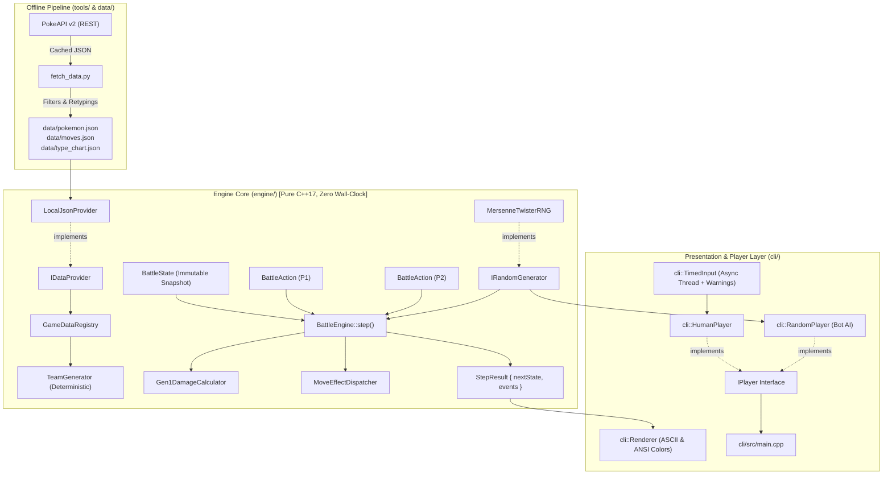
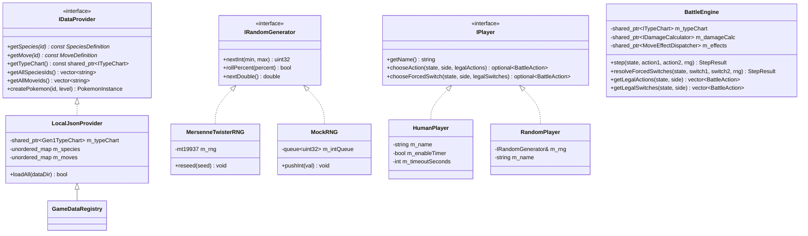
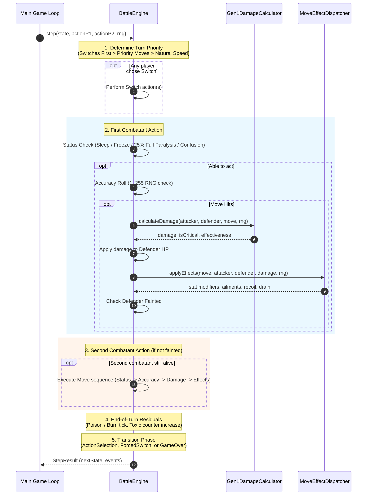
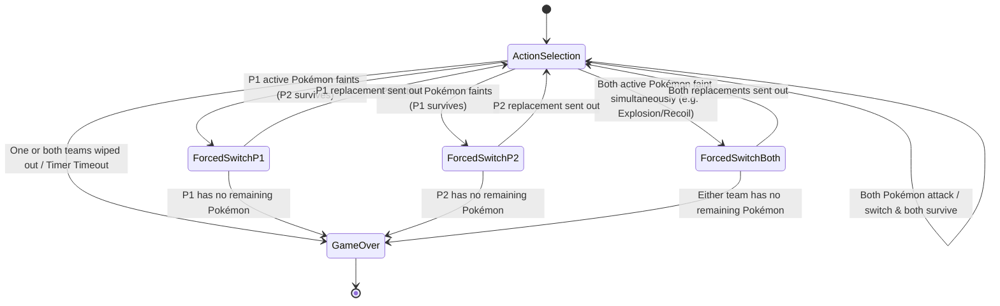

# BattleSimulator CLI

[](https://github.com/namitgupta21/BattleSimulator/actions/workflows/ci.yml)


-brightgreen.svg?logo=google)


A pure, deterministic, faithfully modeled Generation 1 Pokémon battle simulation engine and interactive CLI written in modern **C++17**.

Engineered following strict **SOLID design principles**, the core simulation logic is 100% decoupled from wall-clock time, filesystems, and presentation layers. It operates as a pure state-transition function:

$$\text{step}(S_t, A_1, A_2, \text{RNG}) \longrightarrow (S_{t+1}, \vec{E})$$

---

## 📌 Repository Metadata

* **Short Description (GitHub "About" summary)**:  
  *High-performance, deterministic Gen 1 Pokémon battle engine and CLI simulator in C++17 with full 151 roster, seeded replays, and turn timers.*
* **Suggested GitHub Topics / Tags**:  
  `pokemon`, `cpp17`, `battle-engine`, `simulation`, `game-engine`, `cli-game`, `deterministic`, `clean-architecture`, `solid-principles`, `googletest`, `pokeapi`

---

## 📑 Table of Contents
1. [Key Features](#-key-features)
2. [Prerequisites & System Setup](#-prerequisites--system-setup)
3. [Building and Running](#-building-and-running)
4. [CLI Command Reference](#-cli-command-reference)
5. [Low-Level Design (LLD)](#-low-level-design-lld)
   - [Component Architecture](#1-component-architecture)
   - [Class & Interface Hierarchy](#2-class--interface-hierarchy)
   - [Turn Execution Sequence](#3-turn-execution-sequence)
   - [Battle Phase State Machine](#4-battle-phase-state-machine)
6. [Gen 1 Game Mechanics Fidelity](#-gen-1-game-mechanics-fidelity)
7. [Deterministic Replay System](#-deterministic-replay-system)
8. [Data Pipeline (PokeAPI Ingestion)](#-data-pipeline-pokeapi-ingestion)
9. [Automated Testing & CI](#-automated-testing--ci)
10. [Legal Disclaimer & Credits](#️-legal-disclaimer--credits)
11. [License](#-license)

---

## ⚡ Key Features

* **Authentic Gen 1 Mechanics**: Speed-based critical hits, unified Special stat, retro-typings, faithful type-matchup quirks (Psychic immune to Ghost; Bug/Poison mutually super-effective), and Gen 1 sleep/paralysis/freeze rules.
* **Full 151 Pokémon Roster**: Supports all 151 Gen 1 Pokémon and over 100 combat moves normalized directly from PokeAPI v2 without any runtime API dependencies.
* **Pure Determinism & Seeded Replays**: Bit-for-bit reproducible battles using Mersenne Twister RNG (`std::mt19937`). Any battle can be replayed identically with `--seed <uint>`.
* **Smart Team Generator**: Deterministically generates balanced 6-Pokémon teams from a seed, guaranteeing at least one usable damaging move and prioritizing STAB coverage.
* **Battle Turn Timer (1.5 min)**: Optional asynchronous countdown timer per turn with warning alerts at 1 min, 30s, 15s, 10s, 5s, 4s, 3s, 2s, and 1s, terminating on timeout with opponent forfeiture.
* **Flexible Modes**: Human vs Bot (PvE), Hotseat 2-Player (PvP), and automated Bot vs Bot simulations.
* **Zero Engine Dependencies**: The engine core compiles without external networking or UI libraries, designed for future WebAssembly (WASM) or server microservice targets.

---

## 💻 Prerequisites & System Setup

To build and run this project on any machine, ensure you have a modern **C++17 compiler**, **CMake 3.16+**, and **Python 3.8+** (for the optional data pipeline).

### 🪟 Windows
1. **Compiler**: Install [Visual Studio 2022](https://visualstudio.microsoft.com/) (select **"Desktop development with C++"**) **OR** install [MinGW-w64](https://www.mingw-w64.org/) / [MSYS2](https://www.msys2.org/).
2. **CMake**: Install [CMake](https://cmake.org/download/) (select *"Add CMake to the system PATH"*).
3. **Git**: Install [Git for Windows](https://git-scm.com/).
4. **Python**: Install [Python 3.10+](https://www.python.org/downloads/) (check *"Add Python to PATH"*).

### 🐧 Ubuntu / Debian Linux
Run the following in your terminal:
```bash
sudo apt-get update
sudo apt-get install -y build-essential cmake ninja-build g++ git python3 python3-pip
```

### 🍎 macOS
Using [Homebrew](https://brew.sh/):
```bash
brew install cmake ninja git python3
# Xcode Command Line Tools provide Clang with C++17 support:
xcode-select --install
```

---

## 🚀 Building and Running

### 1. Clone the Repository
```bash
git clone https://github.com/namitgupta21/BattleSimulator.git
cd BattleSimulator
```

### 2. Configure and Compile
Using CMake (works identically on Windows, Linux, and macOS):
```bash
# Configure build directory in Release mode
cmake -B build -DCMAKE_BUILD_TYPE=Release

# Compile engine library, CLI game, and GoogleTest suite
cmake --build build --config Release
```

### 3. Run Automated Tests
```bash
ctest --test-dir build --output-on-failure
```
*(Or run the test binary directly: `./build/tests/pokemon_tests` on Linux/macOS or `.\build\tests\pokemon_tests.exe` on Windows).*

### 4. Start Playing
```bash
# Start an interactive PvE battle (Human vs Rival Bot)
./build/cli/pokemon_cli
```

---

## 🎮 CLI Command Reference

The executable supports comprehensive command-line flags:

```bash
pokemon_cli [options]
```

| Flag | Parameter | Default | Description |
| :--- | :--- | :--- | :--- |
| `--mode` | `pve` \| `pvp` \| `bot` | `pve` | **pve**: Human vs Bot.<br>**pvp**: Local 2-Player Hotseat.<br>**bot**: Automated Bot vs Bot simulation. |
| `--timer`, `-t` | *None* | `OFF` | Enables the battle turn timer (default: 90 seconds / 1.5 min per move). |
| `--no-timer` | *None* | `ON` | Explicitly disables the turn timer (prompt will not appear). |
| `--turn-time` | `<seconds>` | `90` | Sets a custom turn duration in seconds (e.g., `--turn-time 30` automatically enables the timer). |
| `--seed` | `<uint64>` | Random | Sets the master RNG seed for deterministic battle replays and roster generation. |
| `--team-seed` | `<uint64>` | `seed` | Overrides the RNG seed specifically for roster generation while rolling fresh in-battle RNG. |
| `--preset` | *None* | `false` | Uses iconic classic competitive teams (Snorlax, Alakazam, Tauros, Starmie, Zapdos, Gengar) instead of randomized rosters. |
| `--random` | *None* | `true` | Uses the deterministic TeamGenerator to build random legal teams. |
| `--data` | `<path>` | `data` | Custom path to the directory containing `pokemon.json`, `moves.json`, and `type_chart.json`. |
| `--help` | *None* | — | Displays the help and usage menu. |

### Example Invocations

```bash
# 1. Standard game with 1.5-minute turn timer
./build/cli/pokemon_cli --timer

# 2. Fast blitz game with a 15-second timer per move
./build/cli/pokemon_cli --turn-time 15

# 3. Two-player hotseat match with iconic classic Gen 1 teams
./build/cli/pokemon_cli --mode pvp --preset

# 4. Headless Bot-vs-Bot simulation with an exact replay seed
./build/cli/pokemon_cli --mode bot --seed 1259288583660435056

# 5. Play with the exact same Pokémon rosters but roll fresh battle RNG
./build/cli/pokemon_cli --team-seed 1259288583660435056
```

---

## 📐 Low-Level Design (LLD)

### 1. Component Architecture
The system is divided into three isolated layers: **Offline Data Pipeline**, **Pure Engine Core**, and **Presentation/CLI**.



---

### 2. Class & Interface Hierarchy
Employs the **Dependency Inversion Principle (DIP)** and **Strategy Pattern** across all critical subsystems:



---

### 3. Turn Execution Sequence
The resolution pipeline within `BattleEngine::step()` faithfully matches Gen 1 battle rounds:



---

### 4. Battle Phase State Machine
Battles transition through strict deterministic phases:



---

## 🎯 Gen 1 Game Mechanics Fidelity

The engine enforces canonical Generation 1 mechanics:

1. **Unified Special Stat**:
   * Gen 1 did not have separate Special Attack and Special Defense stats. The single `Special` stat calculates both special damage dealt and special damage received.
2. **Authentic Gen 1 Damage Formula**:
   $$\text{LevelFactor} = \left\lfloor \frac{2 \times \text{Level} \times C}{5} \right\rfloor + 2$$
   $$\text{BaseDamage} = \left\lfloor \frac{\text{LevelFactor} \times \text{Power} \times \frac{A}{D}}{50} \right\rfloor + 2$$
   $$\text{Damage} = \lfloor \text{BaseDamage} \times \text{STAB} \times \text{Type}_1 \times \text{Type}_2 \times \frac{R}{255} \rfloor$$
   *where $R \in [217, 255]$ is uniform random variance.*
3. **Speed-Based Critical Hits ($C$)**:
   * Regular moves: Threshold $T = \lfloor \text{BaseSpeed} / 2 \rfloor$.
   * High-crit moves (*Slash*, *Razor Leaf*, *Crabhammer*): Threshold $T = \min(255, 4 \times \text{BaseSpeed})$.
   * Critical hits double the attacker's level ($C = 2$) and **ignore all attacker and defender stat stage modifiers**.
4. **Status Conditions**:
   * **Burn (BRN)**: Halves effective Attack stat; inflicts $\lfloor \text{MaxHP} / 16 \rfloor$ turn-end residual damage.
   * **Poison (PSN)**: Inflicts $\lfloor \text{MaxHP} / 16 \rfloor$ turn-end residual damage.
   * **Paralysis (PAR)**: Cuts Speed to $25\%$ ($\times 0.25$); $25\%$ chance of full paralysis each turn.
   * **Sleep (SLP)**: Lasts 1–7 turns. A Pokémon waking up **cannot move on its wake-up turn**.
   * **Freeze (FRZ)**: Pokémon is completely immobilized and does not thaw naturally.
5. **Simultaneous KO Rules**:
   * If both players' final Pokémon faint at the same time (e.g. from *Explosion*, *Self-Destruct*, or recoil from *Double-Edge*), the match ends in a **Draw** (`state.winner = std::nullopt`).

---

## 🔁 Deterministic Replay System

Every battle completed in the simulator displays its reproduction commands:

```text
============================================================
 BATTLE COMPLETE
   Battle Seed : 1259288583660435056
   Team Seed   : 1259288583660435056
 To replay this exact battle:
   .\build\cli\pokemon_cli.exe --seed 1259288583660435056
 To replay just these rosters with fresh battle RNG:
   .\build\cli\pokemon_cli.exe --team-seed 1259288583660435056
============================================================
```

* **`--seed <seed>`**: Replays the **entire battle identically**. The roster, move selections, critical hits, damage rolls, and status procs will execute bit-for-bit the same.
* **`--team-seed <teamSeed>`**: Preserves the **exact same Pokémon and move pools**, but runs fresh randomized in-battle decision making and damage rolls.

---

## 📦 Data Pipeline (PokeAPI Ingestion)

Game data is normalized offline and shipped with the repository in `data/`. The engine **never calls PokeAPI at runtime**.

To re-fetch and generate the dataset from PokeAPI:
```bash
python tools/fetch_data.py
```
* **Disk Caching**: Raw HTTP responses are saved in `tools/.cache/` to ensure re-runs never spam PokeAPI and run in seconds.
* **Retro-Typing Corrections**: Restores Gen 1 typings (e.g., Magnemite is pure `Electric`, not `Electric/Steel`; Clefairy is pure `Normal`, not `Fairy`).
* **Learnset Filtering**: Restricts moves to the canonical `red-blue` version group.
* **Exclusion Reports**: Moves with complex multi-turn mechanics outside Phase 1 are explicitly documented in [`docs/EXCLUDED_MOVES.md`](docs/EXCLUDED_MOVES.md) and [`data/excluded_moves.json`](data/excluded_moves.json).

---

## 🧪 Automated Testing & CI

Continuous Integration runs on every push and pull request across **Ubuntu Linux** and **Windows** via GitHub Actions.

The suite contains **22 GoogleTest test suites** verifying 100% of core engine functionality:

```text
[==========] Running 22 tests from 9 test suites.
[  PASSED  ] DamageCalcTest.KnownReferenceDamageCalculation
[  PASSED  ] DamageCalcTest.SetDamageLevelMoves
[  PASSED  ] TypeChartTest.Gen1FaithfulMatchups
[  PASSED  ] TurnOrderTest.PriorityMovesMoveFirstRegardlessOfSpeed
[  PASSED  ] TurnOrderTest.NaturalSpeedDeterminesOrderWhenPriorityTied
[  PASSED  ] StatusTest.BurnCutsAttackAndDealsTurnEndDamage
[  PASSED  ] StatusTest.SleepBlocksActionAndCannotAttackOnWakeTurn
[  PASSED  ] StatusTest.ParalysisReducesSpeedToQuarter
[  PASSED  ] DeterminismTest.IdenticalSeedAndInputsProduceIdenticalBattle
[  PASSED  ] SerializationTest.BattleStateJsonRoundTrip
[  PASSED  ] SerializationTest.EventsJsonRoundTrip
[  PASSED  ] DataProviderTest.LoadsFullGen1Roster
[  PASSED  ] DataProviderTest.EveryPokemonHasUsableDamagingMove
[  PASSED  ] DataProviderTest.EveryPokemonTypeExistsInTypeChart
[  PASSED  ] DataProviderTest.Gen1RetroTypingsFaithful
[  PASSED  ] DataProviderTest.Gen1SpecialStatFaithful
[  PASSED  ] TeamGeneratorTest.DeterministicGenerationWithIdenticalSeed
[  PASSED  ] TeamGeneratorTest.DistinctPokemonOnGeneratedTeam
[  PASSED  ] TeamGeneratorTest.EveryMemberHasAtLeastOneDamagingMove
[  PASSED  ] TeamGeneratorTest.GeneratesUpToFourMovesPerPokemon
[  PASSED  ] SimulationStressTest.MultipleSeededBattlesCompleteWithoutHangsOrCrashes
[  PASSED  ] SimulationStressTest.ReproducibilityOnRandomGeneratedTeams
[==========] 22 tests ran. (100% PASSED)
```

---

## ⚖️ Legal Disclaimer & Credits

### Trademark & Copyright Notice
* **Pokémon**, Pokémon character names, Pokémon Red, Pokémon Blue, Pokémon Yellow, move names, and related indicia are trademarks, registered trademarks, and copyrights of **Nintendo Co., Ltd.**, **Creatures Inc.**, and **GAME FREAK inc.**
* This repository is an **independent, non-commercial, open-source educational project** developed solely to study and demonstrate game engine architecture, deterministic state machines, and clean C++17 design patterns.
* This project is **not** affiliated with, endorsed by, or sponsored by Nintendo, Game Freak, or Creatures Inc.
* **No Copyrighted Game Assets**: This codebase does **not** include, distribute, or require proprietary ROMs, official sprites, textures, audio files, or game binaries. All data structures are normalized numeric statistics and string definitions.

### Credits & Acknowledgments
* **Nintendo & GAME FREAK**: For creating the original Pokémon Generation 1 battle system that inspired this architectural study.
* **[PokeAPI](https://pokeapi.co/)**: For maintaining the open-source Pokémon REST API consumed by our offline data pipeline (`tools/fetch_data.py`).
* **[Smogon](https://www.smogon.com/) & [Pokémon Showdown](https://pokemonshowdown.com/)**: For extensive research and comprehensive technical documentation on Gen 1 cartridge battle mechanics, damage formulas, and type quirks.
* **[nlohmann/json](https://github.com/nlohmann/json)**: JSON for Modern C++ by Niels Lohmann (Licensed under the MIT License).
* **[GoogleTest](https://github.com/google/googletest)**: C++ testing framework by Google LLC (Licensed under the BSD 3-Clause License).

---

## 📄 License
The underlying source code of this software engine is released under the [MIT License](LICENSE). See [`LICENSE`](LICENSE) for full terms and conditions.
